  <picture><source media="(prefers-color-scheme: dark)" srcset="assets/header-dark.svg"><source media="(prefers-color-scheme: light)" srcset="assets/header-light.svg"></picture>

  
  
  

## Current Projects

**[Trellum](https://trellum.ca)**: Agent platform for an F&B operator `IN BETA`

- Isolated agent per tenant, with per-user identity: TOTP, revocable sessions, audit trail
- Tenant data stays on a self-hosted model; cloud fallback is off and enforced in CI
- Reads Toast POS and supplier data, drafts orders, the owner approves

**Learning GTM Engineering**

- Built a platform that sources and scores public-sector agency leads and infers ICP fit and intent from agency documents
- Utilizes [Mistral](ttps://mistral.ai/) Ministral 3 models on [Modal](https://modal.com)

## Selected work

| Project | What it does | Result |
| --- | --- | --- |
| **[StackWatch](https://github.com/LlamzonAmazon/StackWatch)** `Python` `FastAPI` `ClickHouse` `Semgrep` | Exposure agent. Point it at a domain or repo and it reports what the target runs, which vulnerabilities apply, and which are reachable | Four-rung evidence ladder on every finding: present, reachable, exploitable, confirmed |
| **[Asynchronous Federated Learning](https://github.com/LlamzonAmazon/asynchronous-fl)** `Python` `PyTorch` `Flower` | Layer-wise asynchronous updates for federated learning on health IoT devices. Tested on a 37M-parameter ECG model | **49.7% less client upload**, accuracy 83.2% vs 82.7% for synchronous (3 seeds, p = 0.31) |
| **[Country Development Scoring](https://github.com/PlanCatalyst/TSI-Data-Dashboard)** `Python` `React` `D3` `Azure` | 216 countries, 28 indicators, 35 years, 7 pillars. A Python pipeline publishes to Azure Blob and a React app reads it | **97,038 of 97,038** published values re-derived independently, all matched |
| **[Western Sales Club site and CMS](https://westernsalesclub.ca)** `Next.js` `TypeScript` `Supabase` | Live site and CMS for a student organization. Its executives publish events and sponsors without a developer | **TOTP** enforced in Postgres policies on every admin write |

> [!NOTE]
> StackWatch began as a team build at the 2026 SF Tech Week Cyberdefense Hackathon, but I continued to build it solo as more of an automated threat-intelligence team.
> The federated learning work is my thesis. I am the first-author of the paper to be presented at IEEE GLOBECOM 2026 (Macau, December).

## Background

- **Security Analyst, CYBERWELL** (Apr 2025 to Apr 2026)
- **Software Engineer, PlanCatalyst (Plan International Canada)** (Sep 2025 to Apr 2026)
- **BSc Honours, Computer Science, Western University** (2026)

## Tools

| Area | Tools |
| --- | --- |
| Languages |      |
| Backend and data |       |
| Frontend |      |
| Cloud and infra |       |
| Security and AI |       |

## DSA practice

NeetCode 150 and LeetCode. The card rebuilds itself from the [solutions repo](https://github.com/LlamzonAmazon/DSA-Problems) on every push.

