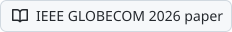

  <picture><source media="(prefers-color-scheme: dark)" srcset="assets/header-dark.svg"><source media="(prefers-color-scheme: light)" srcset="assets/header-light.svg"></picture>

  <a href="https://llamzon.ca"><picture><source media="(prefers-color-scheme: dark)" srcset="assets/buttons/website-dark.svg"><source media="(prefers-color-scheme: light)" srcset="assets/buttons/website-light.svg"></picture></a>
  <a href="https://www.linkedin.com/in/thomasllamzon"><picture><source media="(prefers-color-scheme: dark)" srcset="assets/buttons/linkedin-dark.svg"><source media="(prefers-color-scheme: light)" srcset="assets/buttons/linkedin-light.svg"></picture></a>
  <a href="https://github.com/LlamzonAmazon/asynchronous-fl/blob/main/paper/main-conference.pdf"><picture><source media="(prefers-color-scheme: dark)" srcset="assets/buttons/paper-dark.svg"><source media="(prefers-color-scheme: light)" srcset="assets/buttons/paper-light.svg"></picture></a>

Production AI agents for food and beverage operators, built with a SOC analyst's habits: access control, audit trails and data boundaries from day one.

## Now

**Trellum**: agent platform for an F&B operator, in beta

- Isolated agent per tenant, with per-user identity: TOTP, revocable sessions, audit trail
- Tenant data stays on a self-hosted model; cloud fallback is off and enforced in CI
- Reads Toast POS and supplier data, drafts orders, the owner approves

**GTM engineering**: private

- Sources and scores public-sector leads, infers `fit x intent` from agency documents
- Ministral 3 models on [Modal](https://modal.com)

## Selected work

| Project | What it does | Result |
| --- | --- | --- |
| **[StackWatch](https://github.com/LlamzonAmazon/StackWatch)** `Python` `FastAPI` `ClickHouse` `Semgrep` | Exposure agent. Point it at a domain or repo and it reports what the target runs, which vulnerabilities apply, and which are reachable | Four-rung evidence ladder on every finding: present, reachable, exploitable, confirmed |
| **[Asynchronous Federated Learning](https://github.com/LlamzonAmazon/asynchronous-fl)** `Python` `PyTorch` `Flower` | Layer-wise asynchronous updates for federated learning on health IoT devices. Tested on a 37M-parameter ECG model | **49.7% less client upload**, accuracy 83.2% vs 82.7% for synchronous (3 seeds, p = 0.31) |
| **[Country Development Scoring](https://github.com/PlanCatalyst/TSI-Data-Dashboard)** `Python` `React` `D3` `Azure` | 216 countries, 28 indicators, 35 years, 7 pillars. A Python pipeline publishes to Azure Blob and a React app reads it | **97,038 of 97,038** published values re-derived independently, all matched |
| **[Western Sales Club site and CMS](https://westernsalesclub.ca)** `Next.js` `TypeScript` `Supabase` | Live site and CMS for a student organization. Its executives publish events and sponsors without a developer | **TOTP** enforced in Postgres policies on every admin write |

> [!NOTE]
> StackWatch began as a team build at the SF Tech Week Cyberdefense Hackathon and continued solo. The federated learning work is my thesis, a first-author paper at IEEE GLOBECOM 2026 (Macau, December).

## Background

- **Security Analyst, CYBERWELL** (Apr 2025 to Apr 2026): on call across 7 client tenants, wrote KQL detections, resolved 8+ incidents a day, cut false positives 12%
- **Software Engineer, PlanCatalyst** (Sep 2025 to Apr 2026): built the ingestion pipeline, scoring and publish path for the scoring engine
- **BSc Honours, Computer Science, Western University** (2026): databases, networking, security, algorithms

## Tools

| Area | Tools |
| --- | --- |
| Languages | <picture><source media="(prefers-color-scheme: dark)" srcset="assets/labels/python-dark.svg"><source media="(prefers-color-scheme: light)" srcset="assets/labels/python-light.svg"></picture> <picture><source media="(prefers-color-scheme: dark)" srcset="assets/labels/typescript-dark.svg"><source media="(prefers-color-scheme: light)" srcset="assets/labels/typescript-light.svg"></picture> <picture><source media="(prefers-color-scheme: dark)" srcset="assets/labels/sql-dark.svg"><source media="(prefers-color-scheme: light)" srcset="assets/labels/sql-light.svg"></picture> <picture><source media="(prefers-color-scheme: dark)" srcset="assets/labels/bash-dark.svg"><source media="(prefers-color-scheme: light)" srcset="assets/labels/bash-light.svg"></picture> <picture><source media="(prefers-color-scheme: dark)" srcset="assets/labels/kql-dark.svg"><source media="(prefers-color-scheme: light)" srcset="assets/labels/kql-light.svg"></picture> |
| Backend and data | <picture><source media="(prefers-color-scheme: dark)" srcset="assets/labels/fastapi-dark.svg"><source media="(prefers-color-scheme: light)" srcset="assets/labels/fastapi-light.svg"></picture> <picture><source media="(prefers-color-scheme: dark)" srcset="assets/labels/nodejs-dark.svg"><source media="(prefers-color-scheme: light)" srcset="assets/labels/nodejs-light.svg"></picture> <picture><source media="(prefers-color-scheme: dark)" srcset="assets/labels/postgresql-dark.svg"><source media="(prefers-color-scheme: light)" srcset="assets/labels/postgresql-light.svg"></picture> <picture><source media="(prefers-color-scheme: dark)" srcset="assets/labels/clickhouse-dark.svg"><source media="(prefers-color-scheme: light)" srcset="assets/labels/clickhouse-light.svg"></picture> <picture><source media="(prefers-color-scheme: dark)" srcset="assets/labels/supabase-dark.svg"><source media="(prefers-color-scheme: light)" srcset="assets/labels/supabase-light.svg"></picture> <picture><source media="(prefers-color-scheme: dark)" srcset="assets/labels/pandas-dark.svg"><source media="(prefers-color-scheme: light)" srcset="assets/labels/pandas-light.svg"></picture> |
| Frontend | <picture><source media="(prefers-color-scheme: dark)" srcset="assets/labels/react-dark.svg"><source media="(prefers-color-scheme: light)" srcset="assets/labels/react-light.svg"></picture> <picture><source media="(prefers-color-scheme: dark)" srcset="assets/labels/nextjs-dark.svg"><source media="(prefers-color-scheme: light)" srcset="assets/labels/nextjs-light.svg"></picture> <picture><source media="(prefers-color-scheme: dark)" srcset="assets/labels/vite-dark.svg"><source media="(prefers-color-scheme: light)" srcset="assets/labels/vite-light.svg"></picture> <picture><source media="(prefers-color-scheme: dark)" srcset="assets/labels/tailwind-dark.svg"><source media="(prefers-color-scheme: light)" srcset="assets/labels/tailwind-light.svg"></picture> <picture><source media="(prefers-color-scheme: dark)" srcset="assets/labels/d3-dark.svg"><source media="(prefers-color-scheme: light)" srcset="assets/labels/d3-light.svg"></picture> |
| Cloud and infra | <picture><source media="(prefers-color-scheme: dark)" srcset="assets/labels/cloudflare-dark.svg"><source media="(prefers-color-scheme: light)" srcset="assets/labels/cloudflare-light.svg"></picture> <picture><source media="(prefers-color-scheme: dark)" srcset="assets/labels/aws-dark.svg"><source media="(prefers-color-scheme: light)" srcset="assets/labels/aws-light.svg"></picture> <picture><source media="(prefers-color-scheme: dark)" srcset="assets/labels/azure-dark.svg"><source media="(prefers-color-scheme: light)" srcset="assets/labels/azure-light.svg"></picture> <picture><source media="(prefers-color-scheme: dark)" srcset="assets/labels/terraform-dark.svg"><source media="(prefers-color-scheme: light)" srcset="assets/labels/terraform-light.svg"></picture> <picture><source media="(prefers-color-scheme: dark)" srcset="assets/labels/docker-dark.svg"><source media="(prefers-color-scheme: light)" srcset="assets/labels/docker-light.svg"></picture> <picture><source media="(prefers-color-scheme: dark)" srcset="assets/labels/actions-dark.svg"><source media="(prefers-color-scheme: light)" srcset="assets/labels/actions-light.svg"></picture> |
| Security and AI | <picture><source media="(prefers-color-scheme: dark)" srcset="assets/labels/semgrep-dark.svg"><source media="(prefers-color-scheme: light)" srcset="assets/labels/semgrep-light.svg"></picture> <picture><source media="(prefers-color-scheme: dark)" srcset="assets/labels/sentinel-dark.svg"><source media="(prefers-color-scheme: light)" srcset="assets/labels/sentinel-light.svg"></picture> <picture><source media="(prefers-color-scheme: dark)" srcset="assets/labels/entra-dark.svg"><source media="(prefers-color-scheme: light)" srcset="assets/labels/entra-light.svg"></picture> <picture><source media="(prefers-color-scheme: dark)" srcset="assets/labels/claude-dark.svg"><source media="(prefers-color-scheme: light)" srcset="assets/labels/claude-light.svg"></picture> <picture><source media="(prefers-color-scheme: dark)" srcset="assets/labels/ollama-dark.svg"><source media="(prefers-color-scheme: light)" srcset="assets/labels/ollama-light.svg"></picture> <picture><source media="(prefers-color-scheme: dark)" srcset="assets/labels/pytorch-dark.svg"><source media="(prefers-color-scheme: light)" srcset="assets/labels/pytorch-light.svg"></picture> |

## DSA practice

NeetCode 150 and LeetCode. The card rebuilds itself from the [solutions repo](https://github.com/LlamzonAmazon/DSA-Problems) on every push.

